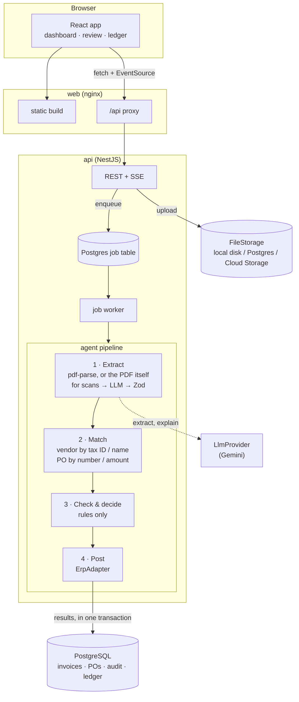

# InvoiceFlow

**Live demo:** [https://rudrakshsoni-dev.github.io/invoice-flow/](https://rudrakshsoni-dev.github.io/invoice-flow/) · **API:** [https://invoiceflow-api-kw3g.onrender.com](https://invoiceflow-api-kw3g.onrender.com) · **Demo video (90 s):** to be recorded from [`docs/demo-script.md`](docs/demo-script.md)

> **The first load can take up to a minute.** The live demo runs on free hosting, and its server sleeps after an hour without visitors. The page says when it is waking up, and everything is fast after that. To see the whole flow without waiting, watch the video.

Accounts payable teams still retype vendor invoices into their ERP, check each one against a purchase order by hand, and catch over-billing and duplicates only when someone happens to notice. InvoiceFlow is an AI agent that does that first pass: it reads an invoice PDF, extracts the fields, matches the vendor and purchase order, flags anything that doesn't add up, and posts clean invoices to the ledger on its own. Anything it is not sure about goes to a person, with the discrepancy highlighted and explained in plain English, and every step is in an audit trail.

## How it works



1. **Extract.** Text PDFs go through `pdf-parse`. Scans, which have no text layer, are sent to the model as the PDF itself. The model's JSON is untrusted: it is validated with Zod, and on failure the validation errors are sent back for up to 2 retries before the invoice is marked `FAILED` with the raw output kept for debugging.
2. **Match.** Vendor by tax ID, then by fuzzy name. Purchase order by the number on the invoice, or by vendor and amount when the number is missing. A duplicate is the same vendor and invoice number.
3. **Check and decide.** Plain rules: subtotal against the PO's remaining balance, line quantities, currency, duplicates, unknown vendor, and confidence below 0.85. Anything above INFO severity, or low confidence, goes to `NEEDS_REVIEW`, and the model writes a short explanation for the reviewer.
4. **Post.** Auto-approved invoices, and invoices a reviewer approves, are posted through `ErpAdapter` (a mock ERP: Postgres ledger tables) and billed against the PO.

All results of one run are written in a single transaction, every LLM call is logged (prompt version and hash, latency, tokens, outcome), and the UI updates live over server-sent events.

## Design decisions and trade-offs

- **The LLM reads; rules decide.** The model is good at turning messy documents into fields and at explaining a problem in plain English. Whether an invoice gets paid is a deterministic check against the PO that a finance team can read, test and trust. The model never approves anything.
- **Never silently auto-approve.** Confidence is the lowest field-group confidence, lowered for scans and capped when the invoice's own arithmetic is wrong. Below the threshold, or on any PO mismatch, a human decides.
- **Money is integers.** Minor units plus a currency code everywhere; amounts are compared pre-tax against PO balances.
- **Boring infrastructure.** A Postgres job table with `SKIP LOCKED` instead of Redis, an in-process event bus for live updates, and one mock ERP adapter behind an interface a real ERP could implement.
- **Swappable model.** All calls go through `LlmProvider`; prompts are versioned files in `apps/api/src/agent/prompts/`.

More detail, including the data model and every rule, is in [`DESIGN.md`](DESIGN.md).

## Run locally

Requires Node 22+, pnpm and Docker. Put a Gemini key in `.env` as `LLM_API_KEY`.

```sh
cp .env.example .env && docker compose up --build      # http://localhost:8080
curl -X POST localhost:8080/api/demo/reset             # load the demo vendors, POs and history
```

For development (hot reload, API on :3000, web on :5173):

```sh
docker compose up -d --wait postgres                   # set POSTGRES_PORT and DATABASE_URL if 5432 is taken
pnpm install && pnpm --filter api prisma migrate dev && pnpm --filter api prisma db seed
pnpm dev
```

No key? `pnpm --filter api serve:fixtures` starts the API on :3100 with a stand-in model that knows the 10 sample invoices; run the web app against it with `API_PROXY_TARGET=http://localhost:3100 pnpm --filter web dev`.

## Checks

```sh
pnpm lint && pnpm typecheck && pnpm test
pnpm e2e    # Playwright: reset demo → upload → auto-approved → ledger (first run: npx playwright install chromium)
```

CI runs all of these on every push.

## Deploy

The web app runs on Vercel, the API on Koyeb's free instance (the API Docker image, with the job worker), and Postgres on Neon. Invoice files are stored in Postgres, and visitor uploads are deleted after 24 hours.

1. **Neon:** create a database and copy its **direct** (non-pooled) connection string. The API runs migrations through it at startup, which a pooler breaks.
2. **Koyeb:** Create Web Service → GitHub → this repo, branch `main`, and choose these settings:
   - **Builder:** Dockerfile, Dockerfile location `apps/api/Dockerfile`, work directory left at the repo root
   - **Instance:** Free (Frankfurt or Washington, D.C.)
   - **Port:** `8080` (HTTP), with the health check on path `/health`
   - **Environment variables:** `PORT=8080`, `STORAGE_DRIVER=db`, `UPLOAD_RETENTION_HOURS=24`, `LLM_PROVIDER=gemini`, `LLM_MODEL=gemini-2.5-flash`, and the secrets `DATABASE_URL` and `LLM_API_KEY`. Also set `APP_BASE_URL` to the Vercel URL from step 3; a placeholder is fine for the first deploy.

   Then load the demo data:

   ```sh
   curl -X POST https://<api>.koyeb.app/demo/reset
   ```

3. **Vercel:** import the repo, set Root Directory to `apps/web`, and set `VITE_API_URL=https://<api>.koyeb.app`. `apps/web/vercel.json` covers the build and SPA routing. Then put the Vercel URL in Koyeb's `APP_BASE_URL` (CORS) and redeploy the API.

The browser calls the API directly rather than through a Vercel rewrite, so the SSE stream and 10 MB uploads aren't subject to proxy limits.

The free instance is small (512 MB RAM, 0.1 vCPU), so startup and PDF parsing are slow but adequate for one demo user. It scales to zero after an hour without traffic and wakes on the next request; queued jobs resume when it does. Any paid instance size removes both limits.

### Alternative: Render

`render.yaml` is a Render Blueprint with the same settings (New → Blueprint). On the free plan the API sleeps after 15 idle minutes and takes about a minute to wake.

### Alternative: Cloud Run

`deploy/cloud-run.sh` deploys both apps to Cloud Run, with invoice files in Cloud Storage, secrets in Secret Manager, and visitor uploads deleted after 24 hours. It is safe to re-run.

```sh
PROJECT_ID=my-project DATABASE_URL='postgresql://...' LLM_API_KEY=... deploy/cloud-run.sh
```

Use a direct (non-pooled) connection string for a managed Postgres such as Neon or Cloud SQL. The API runs as one instance with CPU always allocated, because the worker processes jobs in the background and live updates are in-process. Set `MIN_INSTANCES=0` to let it scale to zero, at the cost of a slow first visit.

## Evaluation and known limitations

- **Extraction accuracy** on the 10 fixtures is measured by `pnpm --filter api eval` and recorded in [`docs/eval.md`](docs/eval.md). Target: 90% of fields correct. It has not been run against the real model yet.
- **One instance.** Live updates use an in-process bus; scaling out means Postgres `LISTEN/NOTIFY`.
- **Gemini only.** `anthropic` and `openai` are accepted in config but not implemented.
- **Reviewers edit header fields and the vendor,** not individual line items. Edits do not re-run the checks; the edit and the decision are the audit record.
- **Open demo.** No sign-in; anyone with the link can upload invoices or reset the demo data.

## Next steps

- Email ingestion: forward invoices to an address and the agent processes them.
- Real ERP adapters (e.g. QuickBooks, SAP) behind `ErpAdapter`.
- Vendor follow-up agent for overdue or disputed invoices.
- Approval policies and spend limits by role.
- Feedback loop: reviewer corrections feed back into prompt examples.

## Layout

- `apps/api`: NestJS API, agent pipeline, Prisma schema and seed
- `apps/web`: React + Vite + Tailwind frontend
- `fixtures/seed`: vendors and purchase orders
- `fixtures/invoices`: 10 sample invoices covering each pipeline path, with ground truth in `manifest.json` (`pnpm --filter api fixtures:generate` re-renders them)
- `fixtures/history`: the past invoices the demo opens with (the "Reset demo data" footer button restores them)
- `apps/web/vercel.json`: Vercel deploy config (web); `render.yaml`: Render Blueprint (API, alternative to Koyeb)
- `deploy`: Cloud Run deploy script (alternative)
- `docs`: demo script, eval results, deferred work
